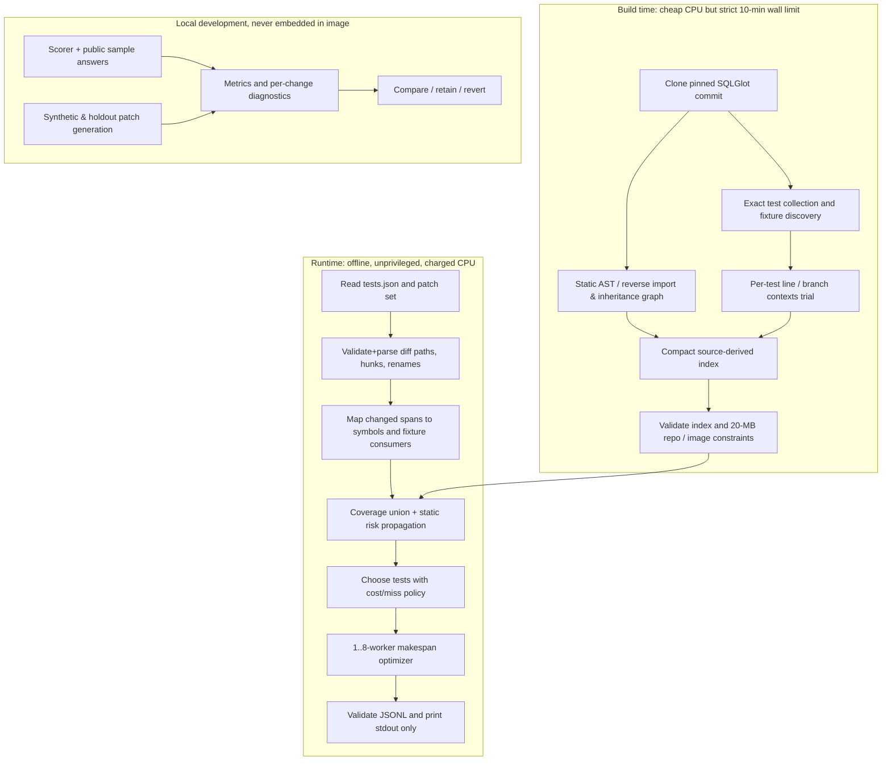

# RWX Blast Radius — Research-Driven Engineering Design

**Project:** RWX / Builders Buildathon, November 20–22, 2026  
**Repository:** `https://github.com/Qua5eyeNimbl/rwx-blast-radius`  
**Local Windows project:** `C:\rwx-blast-radius`  
**Status:** Design and research, **not** an implemented/validated v2  
**Priority:** Real hidden-set performance, correctness, legal reproducibility, and deadline survival.  
**Required reading:** [`SOURCES.md`](SOURCES.md), [`REFERENCES.md`](REFERENCES.md), [`EXPERIMENTS.md`](EXPERIMENTS.md), [`RISK_REGISTER.md`](RISK_REGISTER.md).

## 1. Executive decision

Build a **hybrid, change-aware regression test selector** with four independent evidence layers:

1. **Precise changed-symbol/hunk classification:** parse unified diffs; distinguish executable lines, definitions, imports, decorators, fixtures, and non-runtime text with AST/CST and source provenance.
2. **Per-test dynamic line/branch coverage:** build an inverted map from the *unchanged pinned SQLGlot commit*, using pytest-cov's test contexts where feasible.
3. **Static reverse dependency + test fixture graph:** compensate for coverage blindness to unseen branches, inheritance, registration, module import effects, and shared data.
4. **Risk-/cost-aware candidate selection and scheduling:** choose sets whose estimated chance of avoiding a 300-second **per-commit** miss is worth their recorded duration and worker overhead. Validate on unseen/synthetic changes; never build a sample-answer table.

**Do not launch a full rewrite or machine-learning project on day one.** First establish a valid Docker run, inspect the pinned source, and collect *evidence* that each new layer pays for its complexity. A source-derived graph plus a fast fallback may outperform elaborate ML in the limited time.

## 2. What is mathematically possible

From the supplied `SCORING.md`:

For commit `c`, choose up to 8 nonempty workers `W_c`; let `d_t` be each test's duration in *integer milliseconds* and `F_c` its unknown failing-test set.

```
L_c = 0                                      if no tests selected
L_c = max_w(sum_{t in w} d_t) + 2000 * |W_c| otherwise
M_c = 1  if F_c is NOT a subset of selected tests, else 0
TOTAL = (sum_c L_c + 300000 * sum_c M_c) / 1000 + charged_CPU_seconds
```

The score is the median of 3 official total runs (5 on the finalists' quiet machine), rounded to 0.1 seconds. **A miss is counted once per commit, even if multiple failing tests were omitted**. Even one *nonempty worker* has a 2-second overhead. Empty predictions cost zero. See [S01], [S02].

Our current public-sample facts, inspected from uploaded files (not hidden evaluation):

| Metric | Value | Evidence |
|---|---:|---|
| Sample changes | 30 | `sample/commits/*.patch` |
| Numbered tests | 1,620 | `sample/tests.json` |
| Distinct test files | 58 | test inventory |
| Skipped tests (unnumbered) | 1 | `sample/tests.json` |
| Changes with any failing tests | 18 | `sample/answers.json` (evaluation only) |
| Changes without failing tests | 12 | same |
| Distinct tests that fail across sample | 51 | same |
| v0.1 sample score | 494.300s | user ran scorer locally; matches supplied build notes |
| v0.1 sample missed changes | 0 | supplied answers and user's scorer |
| **Sample lower bound from worker overhead alone** | **36s** | 18 failing commits × 2s minimum |
| **Falling-test-only hypothetical, existing LPT scheduler** | **94.351s** | computed offline from **known sample answers**, *not* available to selector |

The 94.351s number is an **oracle-style reference, not a legitimate attainable prediction or a hidden score forecast**. It may be above the precise optimal schedule for that oracle set. A one-second total is mathematically incompatible with selecting even one test on this sample. Treat 1s as a north star, *not a claimed feasible target*. The official hidden/final distributions differ.

The current leaderboard's ~197s can change at any moment and is scored on different commits than our public sample. Do **not** compare the two as controlled benchmarks. [S01]

## 3. Organizers' hard contract (never regress)

- Input: `/data/tests.json`, `/data/commits/<id>.patch` for independent diffs against SQLGlot commit `eb11aec4be8cb2122afe713a4816662c3f0fb2fa`.
- Output: UTF-8 JSONL, one object per patch: `{ "commit": "id", "workers": [[12, 845], [3, 77]] }`.
- Exactly `commit` and `workers` keys; no duplicated/unknown commits, tests, or extra stdout.
- At most 8 **nonempty** worker lists; any ordering is allowed.
- Build: linux/amd64, 4 CPU / 8 GB / 10 minutes; permitted network sources only; clean rebuild.
- Run: no network, 2 CPU / 4 GB, 3 minutes practice / 4.5 minutes final; read-only filesystem; `nobody`; `/tmp` 64 MB; 256 process maximum; stdout cap 2 MB.
- Repository: public, <20 MB; top-level Dockerfile. Git submodules/LFS not fetched. Final rebuild uses selected immutable commit.
- Runtime SQLGlot test execution is permitted but **all CPU consumed by the container** is charged.
- Only pinned-commit-derived coverage/import/fixture maps may be packaged. **No worked-out patch→failure answers or edit-kind→failure lookups.**
- Source code must remain MIT-licensed. Your team alone must own and submit its repo. See [S01], [S02], [S03].

### Exact test/environment details

`tests.json` contains stable `number`, `id`, `file`, and `seconds` fields; `skipped` test IDs have **no test numbers**. The pinned labeling environment uses the organizer's `requirements.lock` and Python base-image digest, with `SKIP_INTEGRATION=0` when labeling. Pytest 9 `unittest.subTest()` can yield `SUBFAILED` while the parent test also has `PASSED`; failure detection must count *any* failing subtest as failure of the numbered parent. Reproduce those settings for local holdout experiments. [S02], [S06]

## 4. Reference architecture



**Build vs packaged maps:** a 10-minute full-image build may fail if Python dependencies and complete context coverage are installed and executed each time. Test feasibility locally first. If it is too slow, make a deterministic offline indexing script driven only by the pinned base revision; commit its *small* resulting map, regenerate/check hashes reproducibly, and explicitly confirm that this satisfies the allowed pinned-commit-map rule. Do not package maps generated from sample patches or answer labels.

## 5. Component detail

### 5.1 Diff parser (a correctness prerequisite)

Parse `diff --git`, `---` / `+++`, `@@ -old_start,old_count +new_start,new_count @@` hunks; handle `\t` suffixes, `a/` / `b/` prefixes, `/dev/null`, added/deleted files, renames, no-newline markers, paths containing spaces/quotes, and ambiguous malformed diffs. Preserve both preimage and postimage ranges; a deleted line still affects the *original* definition. Avoid the current v0.1's overly simplistic path-only behavior (it reads only `---`, `+++`, rename lines). Fail conservatively rather than silently returning zero when parsing fails.

Store per change:

```text
PatchChange = {old_path, new_path, status, old_hunks[], new_hunks[], changed_lines[], parse_confidence}
```

**No dependence on sample commit IDs or known failing test sets.**

### 5.2 Semantic span analysis

Use Python `ast` first (standard library and fast). Index definitions with `[lineno, end_lineno]`, enclosing classes, decorators, and imports. Changes to module-level statements or imports have larger possible scope. A code move or rename may change import behavior even when function bodies match. Use `LibCST` only in a measured second phase if comments/whitespace-aware span mapping materially reduces ambiguity. LibCST preserves formatting and comments and offers position/qualified-name providers; it is widely used, but *has not been tested for this specific pinned project* [S08].

Categorize changes into **proven behavior-preserving**, **likely local**, **shared/API/registration**, and **unknown/risky**. The category estimates *scope*, not a precomputed failing-test label. Do **not** assume comment-only patches are safe: comments in SQL fixtures, strings, doctests, parsing edges, or module metadata may matter; the challenge explicitly disclaims safety. [S01]

### 5.3 Dynamic per-test coverage index

Preferred proof-of-concept command, executed against the *pinned* checkout with matching dependencies:

```bash
SKIP_INTEGRATION=0 python -m pytest tests \
  --cov=sqlglot --cov-context=test --cov-branch --cov-report= \
  -q
```

**This is a candidate command, not yet tested on the pinned checkout.** Confirm `pytest-cov` is installed at an approved pinned version and whether this run completes in time. `[coverage run -m pytest ...]` is a second route. Use `coverage.CoverageData.measured_files()` and `contexts_by_lineno(path)` to export an index: `(path, executable line) -> {pytest node IDs}`. Map pytest node IDs exactly onto the numbered IDs in `tests.json`. Process `setup` and `teardown` contexts and empty/import-time contexts as global dependencies, not as safely unobserved code. Test branch/arcs when available; ensure data survives xdist/subprocess collection where relevant. Do not directly depend on undocumented coverage SQLite tables in submitted code. [S04], [S05]

**Key limitation:** lines not executed by baseline tests can become newly reachable under a patch; coverage is a *lower bound on what was observed*, not a proof of nonimpact. Mocking, dynamic dispatch, monkeypatching, C extensions, import-time effects, and fixtures require static propagation and uncertainty fallbacks. This limitation is documented by industrial practitioners [S09], [S10].

### 5.4 Static reverse dependency graph

Build a conservative graph of:

- Module `import` / `from import` dependencies and re-exports.
- Class inheritance, virtual overrides and methods invoked via subclasses.
- Direct imports/calls where resolvable; uncertain dynamic references marked explicitly.
- Fixtures consumed by tests; test-to-helper or test-to-fixture edges.
- SQLGlot dialect registration, parser/generator inheritance, optimizer, expressions, serde, executor and lineage shared helpers.
- Import-time and module-level side effects; affected package initializers.

Rules must be derived by reading the **pinned** project, not assumed from a current upstream version. Do not infer code symbols' consumer sets just from similar filenames. Start with module/file level if finer graph cannot be built in time; add function-level refinement where it reduces largest current costs.

**Cost guard:** a shared utility may transitively touch thousands of test paths. Use branch-aware dynamic coverage to rank affected tests, but retain an explicit fallback for unknown runtime paths. Never label a missing coverage edge as certain non-reachability.

### 5.5 Fixture-aware selection

Inspect test code to determine which SQL fixture files each test reads. Build a source-derived `fixture_path -> exact test ID(s)` map. Handle optimizer `.sql`, dialect fixtures, shared resource loaders, parametrized tests, and indirect fixture references. Include direct test when fixture changes; also include any shared consumers established from code. Fallback to broader test file when map is unresolved. The v0.1 naming heuristic can be a fallback, but not the sole source of truth.

### 5.6 Risk and cost policy

Classify evidence strength for a candidate test; compute approximate costs from **given** durations rather than number of tests:

- `A`: directly covers changed executable line/branch or consumes changed fixture.
- `B`: calls changed function or inherits/dispatches from changed implementation.
- `C`: shares module/import/registration with changed code.
- `U`: unknown fallback, incomplete maps, or diff-parser ambiguity.

Use an explicit policy table of **confidence/impact classes**, not a precomputed *edit-kind→failing-test* answer table. Prefer conservative selection when a miss could cost 300s, but do not add a 28-second test gratuitously. Calibrate thresholds on source-derived evidence, independent holdout changes and an isolated evaluation harness. Sample labels are permissible **only after predictions** for reporting; never for construction of a patch-answer lookup.

**Expected-loss thought experiment:** including additional candidate tests with net incremental selection cost `ΔC` is advantageous if it reduces probability of *at least one missed failure on that commit* by more than `ΔC / 300`. This is intuition, not a calibrated probability. It requires modeling whether failure *sets* are fully covered, not independent per-test misses.

### 5.7 Worker scheduling

Given selected tests and integer durations, minimize `max(loads) + 2000*k` for `1<=k<=8`. Use LPT (longest-processing-time-first) for every `k` as baseline. For `n<=~12–18` or near ties with expensive jobs, *experiment* with branch-and-bound, subset search, or local-search exchanges; measure CPU and benefit. The exact threshold must be benchmarked; `P||Cmax` partitioning is combinatorial and exact search is not always worthwhile. Do not use a giant optimizer dependency without evidence that it reduces *total charged score*. Zero-duration tests still need to be assigned if selected, but they may be free in the makespan for an existing worker.

### 5.8 Optional runtime differential testing

The rules explicitly permit running SQLGlot tests during runtime, with full CPU charge. Treat selective actual test execution as a **research branch**, not a default. For a high-risk commit, applying its patch to an isolated checkout and running carefully chosen very fast tests could reveal real failures and reduce conservative selections. But setup, imports, patch isolation, subprocess creation, 2-core CPU, 3-minute total wall time, and differential-results interpretation can make this worse or invalid. Require an experiment that measures *end-to-end* CPU plus simulated savings and proves independent patches do not contaminate each other.

### 5.9 Non-goal: training a big ML classifier

Meta/Gradle used historical training data across many real changes and executions, plus ongoing feedback, to estimate risk [S09], [S10], [S11]. We have only 30 labeled sample commits. A sophisticated model trained on those answers would likely overfit and risk violating the no-precomputed-answers rule. Build a deterministic hybrid first; investigate lightweight source-derived rankings only if *independent holdout* shows gains and rules permit them.

## 6. Priority roadmap by measurable win

| Rank | Change | Reason | Exit condition |
|---|---|---|---|
| P0 | Docker parity, pinned runtime, stderr/stdout hygiene | Invalid run = no usable score | full `make sample` + `make check` inside supplied limits |
| P0 | source-only fixture-to-test mapping | fixture changes are common in sample | coverage verified, no missing IDs |
| P0 | robust hunk parser and AST symbol intervals | essential for precision | independent parser fixtures pass |
| P1 | coverage contexts spike | best evidence for precise changed-line mapping | >95% test ID mapping or documented gaps; 10-min build feasibility |
| P1 | reverse import / inheritance graph | guard against coverage blind spots | synthetic import/dispatch failures caught |
| P1 | cost-aware selection policy | 300s miss vs many low-cost tests | no sample misses, improved holdout balance |
| P2 | scheduling search | optimize small selected sets | measurable net CPU-adjusted gain |
| P2 | live test execution | possible powerful oracle, high risk | succeeds only on a measured holdout win |
| P3 | advanced ML/LLM selection | little historical training data and latency | no production adoption without holdout superiority |

## 7. Interface and artifacts

Proposed modules (adjust to existing v0.1, do not disrupt teammates):

```text
selector.py                     # Competition entry point (or wrapper)
blast_radius/diff_parser.py
blast_radius/semantic_index.py
blast_radius/dependency_graph.py
blast_radius/fixture_index.py
blast_radius/coverage_index.py
blast_radius/selector.py
blast_radius/scheduler.py
blast_radius/protocol.py
scripts/build_indexes.py         # only pinned source and source-derived data
scripts/evaluate.py              # sample answers allowed HERE, never Docker runtime
scripts/inspect_index.py
tests_local/                     # unit + synthetic + integration tests
artifacts/pinned_index.json.zst  # source-derived only; optional, evaluate package size
```

Boundaries:

```python
parse_patch(patch: str) -> list[Change]
lookup_affected_entities(changes: list[Change], index: Index) -> Evidence
select_tests(evidence: Evidence, test_catalog: list[Test]) -> set[int]
schedule_tests(test_ids: set[int], test_catalog: list[Test]) -> list[list[int]]
validate_response(commit_id: str, workers: list[list[int]], test_catalog: list[Test]) -> None
```

Serialize *only* `{commit,workers}` JSON lines to stdout, with diagnostics on stderr. Validate all output before printing. Use integer milliseconds. For deterministic behavior, sort patch filenames and test numbers and pin every optional dependency.

## 8. Verification and reproducibility

Follow [`EXPERIMENTS.md`](EXPERIMENTS.md) rigorously. Any claimed improvement must state:

- Local public-sample simulated score, misses, total selected tests, selected costly outliers.
- CPU measurement (Windows Python and official-style Linux Docker separately).
- Independent holdout and synthetic outcomes, including failure detection and *where ground truth came from*.
- Docker clean-build time, image size, runtime time, memory, permission and no-network test results.
- Complete git SHA, index content hash, dependency lock state, and selected algorithm policy.

No official submission without a reproducible local container result, an unambiguous green compliance check, and an intentional Git commit. Save the best known good candidate while experimenting on a separate branch.

## 9. Final strategy

The highest chance of winning is **not** “the most innovative model”; it is the smallest legal set of tests that captures failing changes on truly unseen patches. Cut costs by using exact fixture consumers and per-line contexts; protect against misses with static graph propagation and explicit uncertainty. Spend Saturday testing and refining the system while the teammate is alone; freeze a valid, restorable commit with enough margin before Sunday 10 AM Central cutoff. Practice scores are not guaranteed to generalize; only final hidden scoring determines the prize. [S01]
